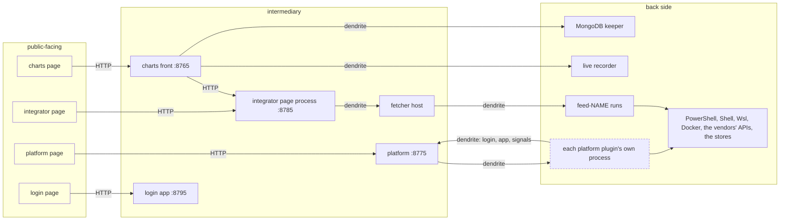
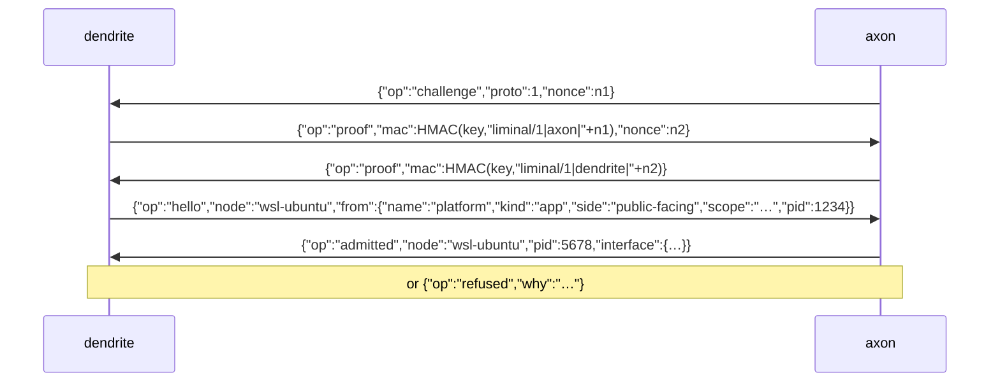
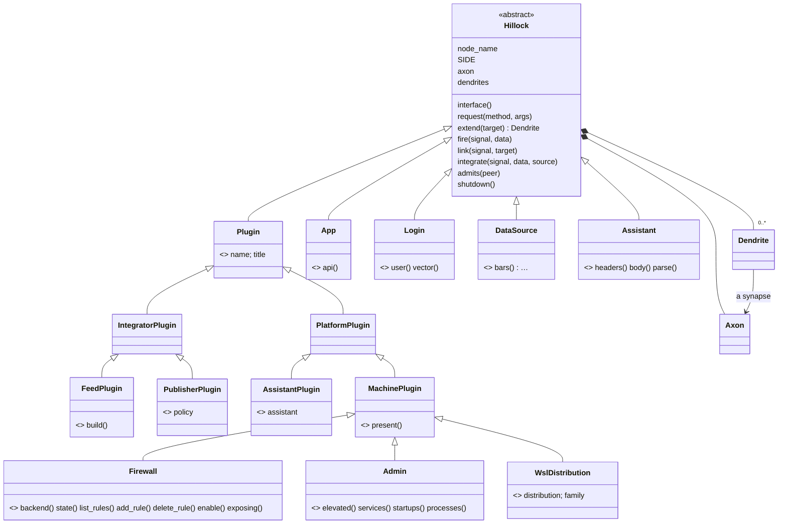

# Liminal as a network of nodes: the conceptual design

Status: **draft for review** (2026-11-09). Nothing here is built yet. Every decision in the log at the end is open
until the user decides it; the code follows only decided items.

## 1. What the user asked for

In the user's words, 2026-11-09:

- "the idea is to make sure all modular code uses abstract base classes as interfaces and Inter Process
  Communication to interact between code objects"
- "ALL ABSTRACT BASE CLASSES PROVIDE ALL INTER-PROCESS COMMUNICATION METHODS, AS WELL, AN 'AXON' from which to
  receive requests, ABC form the foundation for internetworking between code objects and API's" — "*not all"
- "basically all code objects, including parts of plugins become internetworked stateful code objects that interact
  in real time"
- "the hillock will be the ABC that interlinks with other nodes, the axon it's input interface will accept
  connections for input, and dendrites, will extend to other nodes and request access to their axons"
- "also, the nodes are structured much like neural networks"
- "the public facing nodes which interact with the user manage input and display, where as the intermediary nodes
  handle logic, and the back side manages OS/API/low level interactions"
- "we are using the existing libraries as the desired output and input and code organization", "the existing UI"
- "it has to look and behave very much the same way, but requires a very much different kind of paradigm in terms
  of coding, it will also require the ability to be interlinked against different compilers' code and libs" — "like
  i will have rust and maybe c++"
- "this is going to be a very extensive rewrite and conceptual design"; "we will have to walk through a lot of the
  decisions you make in order to make sure nothing is skipped over"

The requirements drawn from them:

| | requirement |
|---|---|
| R1 | It looks and behaves very much the same. The existing UI, and the existing libraries' inputs and outputs, are the reference. |
| R2 | The code organization stays (the repositories, packages, modules). The coding paradigm is very different: nodes that interact only by requests and signals, through axons and dendrites. |
| R3 | Nodes can be interlinked with code and libraries built by other compilers, in other languages (Rust, maybe C++). Nothing on the wire or in an interface may be Python-only. |
| R4 | Structured like a neural network, on three sides: public-facing, intermediary, back side. |
| R5 | Stateful nodes interacting in real time. Nothing runs unless used (the user's rule of 2026-11-01). |
| R6 | Every decision is walked through with the user; nothing is skipped over. |

## 2. The terms

The direction is the user's: a node's **axon** is its input, and its **dendrites** reach out to other nodes. In
biology it is the other way round. The user's mapping is the one used everywhere here.

| term | meaning |
|---|---|
| **node** | A stateful code object of the network: a plugin, a part of a plugin, an app, a login, a source, an assistant, a service. It has a name among the nodes, and its state lives as long as its process. |
| **Hillock** | The abstract base class every node's ABC derives from (`liminal_libs.ipc.Hillock`). "The ABC that interlinks with other nodes": it holds the node's axon and dendrites, integrates what reaches the node, and fires the node's signals. |
| **axon** | A node's input interface. It accepts connections from other nodes' dendrites, admits or refuses them, and receives their requests and the signals fired into it. |
| **dendrite** | A node's link out to another node. It extends to that node's axon, requests access, then carries requests there and brings the answers back. Through it, the node holds the other node as that node's own ABC (a proxy). |
| **synapse** | Where one dendrite meets one axon: a single connection. (The word is this design's, not the user's: decision 2.) |
| **request** | A call of one of a node's interface methods, along a dendrite into the node's axon, answered back. |
| **signal** | Something a node fires: a status changed, a line printed, a sample taken. It travels along the dendrites linked to receive it, into those nodes' axons, and is integrated by their hillocks. It is never answered. |
| **message** | Data that travels between nodes (a status, a rule, an argument, a report), carried by value. A message is not a node: this is the user's "not all". |
| **side** | Where a node stands: public-facing (the user's input and the display), intermediary (logic) or back side (the OS, the APIs, low-level work). |
| **interface** | What a node offers: its methods (with their arguments' and answers' types) and its signals. Its axon serves nothing else. It is described language-neutrally, for Rust and C++ (the IDL, §6). |
| **handle** | How a node, or a callable, is passed in a message: an id the receiver uses to reach it, released explicitly. |
| **scope** | The folder that names a set of nodes' addresses: the reaching app's state folder. Two scopes never share a process. |

## 3. How the network works

### 3.1 Like a neural network

- **Links are directed**: a dendrite reaches an axon. Two nodes that both start conversations hold a synapse each
  way. The platform reaches a plugin, and the plugin reaches the platform for its login and to fire its signals.
- **Requests** go along a dendrite into an axon and come back answered.
- **Signals propagate forward, like activations.** A node fires. Its signal enters every axon its dendrites reach
  for that signal. Each receiving hillock integrates it into its node's state, and may fire in turn.
- **Integration at the hillock**, as in a neuron:
  - a burst of the same state signal becomes one, the latest, at most once per interval (decision 20);
  - nothing fires when nothing changed;
  - stream signals (lines, rows, ticks) are delivered every one, in order (decision 43).
- **Three sides.** The user's input enters at the front. Requests travel through the logic to the back side. What
  happens at the back side fires forward through the logic, integrated at each hillock, to the display. Any node may
  still link to any other.

### 3.2 The three sides, with Liminal's nodes

| side | manages | nodes (the existing classes, in their existing modules) |
|---|---|---|
| public-facing | the user's input and the display | each app's page in the browser and its axon's HTTP side: the charts front (`liminal_charts.gui.front`) and chart server (`gui.server.ChartApp`), the integrator's page process (`liminal_integrator.service`), the platform (`liminal_platform.app.PlatformApp` routes), the login (`liminal_login.app.LoginApp` routes); the views (the charts' Stock, Analysis, Trading, Watchlist, Preferences; the integrator's Exchanges, Markets, News, Federal, Datasets, Live, Fetcher, Plugins, Resources, Databases; the platform's This machine, each plugin's page (its tables, forms and terminal as the platform draws them), Connections); the trays |
| intermediary | logic | the apps' logic (`ChartsApp`, `IntegratorApp` and the `Fetcher` with its assessment and standing pass, the `Service`, `PlatformApp`'s nexus: validity, enabling, attaching, `LoginApp`'s users and vault); the library's logic (`collector.Collector`, `coverage.Planner`, `sourcing.Scheme`/`Scans`, `audit.Auditor`, `initializer.Initializer`, `derive.Builder`, `baddata.Scanner`, `runner.Runner`, `publications.Reader`, `killswitch.KillSwitch`); each plugin's own logic (a feed's plans and declarations, a publisher's feeds and policy, an assistant's plans and models, a machine plugin's hooks: a WSL plugin's installs and steps, a firewall's groups and risk checks, hw-stats' figures, Namecheap's zones); the login (`Login` realizations: `EnvironmentLogin`, `LoginClient`, `RecordingLogin`) |
| back side | the OS, the APIs, low-level work | the drivers (`machines.windows.PowerShell`, `machines.linux.Shell`, `machines.wsl.Wsl`, `docker.Docker`, `machines.terminal.Terminal`'s PTY, `capture`, `netpath`, `dns`, `ports`); the vendor clients (each feed's `DataSource`, `sources.http.HttpClient`, `assistants.AssistantClient`, Namecheap's API client, the publishers' reads, `wsclient` and `sources.stream`'s live feeds); the stores (`storage.Store` on SQLite, `stores` on DuckDB, `mongo`'s keeper); the machine ledgers (`ratelimit.MachineLedger`); `host.py`'s pipes |

A plugin's parts sit on all three sides. The WSL plugin's tables and terminal are on the front, its installs and
steps in the middle, and `Wsl`, `Shell` and `wsl.exe` at the back. So the parts of plugins become nodes on their
own sides (§9, Phase 5).

### 3.3 The processes, today and in the target



Dashed: new in this rewrite. Today the platform's plugins run inside the platform's own process.

## 4. The rules

### 4.1 What crosses, and how

| what | how |
|---|---|
| messages: maps, lists, text, numbers, booleans, null | by value |
| typed records: the library's dataclasses (`Rule`, `Startup`, `docker.Instance`, `Report`, `Scanned`, `Argument` and its kinds ...) | by value, as `{"$type": "<name>", ...fields}`. A Python side rebuilds the dataclass, and another language reads a map with its type. |
| nodes, and callables (a `log`) | by handle, `{"$node": id, "abc": [...]}`. The receiver holds a proxy built from the node's interface description. A handle is answered at its owner's axon (decision 44), and released explicitly when done; a synapse closing releases all of its handles. No language's garbage collector is assumed. |
| errors | records: `{"$error": "ValueError", "type": "<its class>", "message": "...", "accept": ..., "denied": ..., "status": ...}`. A Python side rebuilds the class when it can import it (a plugin's own refusal classes are importable wherever its package is loaded), else a `RemoteError` keeping the builtin base: the platform's 400/502 mapping and a form's second confirmation depend on that. Another language maps them to its own. |

### 4.2 Access

1. **Your key.** The synapse's handshake proves both ends hold the user's key under `~/.liminal/ipc` (§5.2). Only
   this user's processes connect.
2. **The node's `admits(peer)`.** The hello names who is reaching (its node name, kind, side, scope, process), and
   the node's policy admits or refuses: who may connect, and how many. A plugin admits its app's namespace; an app
   admits its plugins. This is the attachment policy the user asked for on 2026-11-03 ("plugins can regulate which
   or how many integrators attach to them").
3. **The login's gating.** What a node may do for the signed-in user stays the `Login` ABC's (`may`, the pairs), as
   on 2026-11-06: "the app plugins need to use the Abstract Base Class login as the only way to present an interface
   for IPC, between plugins and login and the app as far as AUTHORIZATION".

Reach: this machine only, a named pipe on Windows and a socket file on Linux, as `host.py` today. The transport is
pluggable, so reaching other machines would be its own decision later (decision 15).

### 4.3 Lifecycle

- **Nothing runs unless used.** A node's process starts at the first request a dendrite brings it. A disabled plugin
  never starts one. Neither does a node whose only use is declarations or pure functions (§4.6).
- A dendrite with no request and no link for LIMINAL_QUIET_SECONDS (120 s) closes.
- When an axon's last dendrite is gone, its node is told. A resident node then waits a short grace (10 s, for a page
  reload), lets a request in progress finish (a setup step), runs `detach()` and `shutdown()` (securing its data),
  and its process exits. The user, 2026-11-01: "the plugins should have some sort of resident IPC mechanism that
  tells them when the client process is no longer attached, and then presto, the plugin gracefully shuts down after
  all data is secured".
- A request still running when its caller is gone (a setup) finishes. Its lines are kept in the node's own log.

### 4.4 Real time

| member | what it does |
|---|---|
| `fire(signal, data)` | sends a signal along every dendrite linked for it |
| `link(signal, target)` | asks a node to extend a dendrite to `target`'s axon for that signal |
| `unlink(signal, target)` | the reverse |
| `integrate(signal, data, source)` | what a signal arriving at the axon does to the node's state. By default it is kept as the latest (a state signal) or appended (a stream signal), and fired on to whoever links for it from this node. |

- A status watch inside a plugin's process runs only while something links for its `status`, every 5 s (decision
  22), and fires on change.
- Background readers fire as they read: hw-stats' samples, Namecheap's reader, the Windows firewall's reads.
- The pages keep their own polling: the existing UI is the reference (decision 21). An app answers them from its
  integrated state, so a poll no longer asks every plugin in turn.

### 4.5 Placement

- Within one process, nodes call each other directly. The synapse delivers without encoding, and the semantics stay
  those of the wire, so messages are treated as immutable. A test mode encodes even in-process, to prove the two
  behave alike (decision 42).
- Each plugin, with its parts, runs as a resident node in a process of its own. Each app's nodes live in the app's
  process.
- A part shared by several plugins can be a node of its own, in its own process, where sharing pays. One `Wsl` for
  the three WSL plugins would give the one shared `wsl --list --verbose` the helpers asked for.

### 4.6 What stays plain functions, and why

"Where it is not a detriment to performance" (the user, on objects):
- **The hot loops and the pandas work**: the collector's request loops (`sync_bars`, `_fill`, `sync_future` ...),
  the storage queries, derive's aggregation, the calendars' masks (`sessions`), freshness's rules, the bad-data
  rules.
- **Pure functions of declarations and settings**: the delivery scheme, the planners per symbol, an assistant's
  validity (`keys_set`, `served`, `free_note`, `plan_state`, `rate_window`), a feed's `carries`, `markets`,
  `served`, `plan_resolutions`, `request_bars`, `report`. They run in the caller's process, from the declarations
  the registry loaded there. Answering them remotely would cost a round trip per symbol, and would mean shipping a
  `Settings` (every variable, other plugins' keys too) to each plugin.
- **A feed's DataSource inside its run** (the bars' hot path): the run already is its own resident process
  (`feed-NAME`), attached over the pipe and ended when let go.
- **Between apps, HTTP on 127.0.0.1 as today**: page ↔ app, the charts front ↔ the integrator, `LoginClient` ↔ the
  login app. `LoginClient` already is the Login ABC's realization over HTTP: the HTTP side of the login's axon.

### 4.7 Declarations stay where the class is loaded

An app's dendrite to a plugin holds it as `MachineProxy`, `AssistantProxy`, `FeedProxy` or `PublisherProxy`. The
proxy is a registered virtual subclass of the plugin's ABC, so `isinstance` holds and the caller never knows where
the plugin runs.

- **Local, from the registry's instance** (which carries the origin and the version the registry set):
  - every attribute that is not a method, properties included (`name`, `title`, `version`, `ICON`, `STEPS`, `keys`
    (a property on assistants), `key_names`, `options`);
  - `interface()`, with `attached` from the proxy;
  - `gives`, and the pure functions of §4.6.
- **Remote, in the plugin's process**: every other method.
  - `getattr(m, "chosen", None)` with `callable()` is answered from the class, without a round trip.
  - Private names are never forwarded.
- **`app` and `login` are the proxy's own.** They are set on attach, or as the platform sets `m.login = ...`, and
  the plugin's process reaches them through its own dendrites.
- A disabled plugin's whole page (its row, its Settings, Connections, the tray) is answered locally. The survey of
  2026-11-09 checked every access.

## 5. The protocol (language-neutral, for Rust and C++)

### 5.1 Frames

- A frame is a 4-byte big-endian length, then that many bytes of UTF-8 JSON: one message.
- A frame is at most 16 MB. A larger answer is refused with words (decision 45).
- JSON is the encoding (decision 36): Rust's `serde_json`, C++'s `nlohmann::json` and Python's standard library all
  read it.
- CBOR is the binary encoding for later, if measuring shows the need: Rust's `ciborium`, and `nlohmann::json`, which
  speaks it from the same API.

### 5.2 The handshake

Both ends prove they hold the user's key without sending it. It replaces `multiprocessing.connection`'s
Python-specific challenge on the same pipes (decision 39).



HMAC is SHA-256. The nonces are 32 random bytes, in hex. A wrong proof closes the connection, and nothing about
the key is said.

### 5.3 The messages after the hello

| op | from → to | shape | what it does |
|---|---|---|---|
| `request` | dendrite → axon | `{"op":"request","id":7,"node":"wsl-ubuntu","method":"status","args":[],"kwargs":{}}` | calls an interface method; `"handle":12` instead of `"node"` reaches a handle |
| `answer` | axon → dendrite | `{"op":"answer","id":7,"value":…}` | the request's answer |
| `error` | axon → dendrite | `{"op":"error","id":7,"error":{"$error":…}}` | the request failed |
| `fire` | dendrite → axon | `{"op":"fire","signal":"status","from":"wsl-ubuntu","seq":42,"data":…}` | a signal, along the firing node's dendrite |
| `link` / `unlink` | dendrite → axon | `{"op":"link","signal":"status","to":{"node":"platform","scope":"…"}}` | asks the node to extend a dendrite to `to` for that signal |
| `release` | either | `{"op":"release","handles":[12,13]}` | handles no longer held |
| `detach` | dendrite → axon | `{"op":"detach"}` | the dendrite goes; the connection closes after |

- Requests from one dendrite run concurrently at the axon, as today's threaded server does, so answers return
  matched by id, in any order (decision 48).
- A request has no timeout unless its caller gives one: a setup step can take hours (decision 47).
- A synapse closing fails every request in flight with an error record.

### 5.4 Versions

The hello's `proto` is 1. An axon refuses a newer major with words (decision 46). An old `host.py` client (the
dict asks of today) is still answered while the running tasks predate the rewrite (decision 30).

## 6. Interface descriptions (the IDL)

`Hillock.interface()` describes each node's ABC language-neutrally. `python -m liminal_libs.ipc describe` writes
every ABC's description as JSON (decision 38). From them come, later:
- a Rust trait per ABC, implemented by a Rust node and served at its axon by a small `liminal-node` crate;
- a C++ abstract class per ABC.

An ABC, a trait and a pure-virtual class are the same idea.

```json
{"abc": "liminal.MachinePlugin", "side": "intermediary", "base": ["liminal.PlatformPlugin"],
 "methods": {"present": {"args": [], "returns": "bool"},
             "status": {"args": [], "returns": "map"},
             "setup": {"args": [{"name": "log", "type": "node:callable"},
                                {"name": "steps", "type": "list<text>|null", "default": null}],
                       "returns": "list<map>"}},
 "signals": {"status": {"kind": "state", "data": "map"}}}
```

Types come from the ABCs' annotations (decision 40):

| type | Python |
|---|---|
| `text` | `str` |
| `number` | `int`, `float` |
| `bool` | `bool` |
| `null` | `None` |
| `list<…>` | `list`, `tuple` |
| `map` | `dict` |
| `record:<name>` | a library dataclass |
| `node:<abc>` | a node, by handle |
| `node:callable` | a callable, by handle |

A signature that says nothing is annotated as its node moves.

## 7. The paradigm in code (R2)

A node's code never reaches into another node's state.
- It requests through a dendrite. In Python, the proxy's methods are named as the other node's interface, so the
  calling code stays readable: `self.app.machines()`, `self.login.variables([...])`. Underneath, and for other
  languages, it is the explicit form, `request(method, *args)` (decision 41).
- It reacts to signals in `integrate`.
- It fires its own signals with `fire`.



## 8. The inputs and outputs kept (R1)

The existing suites encode them, and pass unchanged; the only exceptions are the tests that instantiate a contract
class directly (Phase 1). Listed here before each phase touches them.

**The platform** (`liminal_platform`, touched in Phase 3):
- **Routes**:
  - `GET /api/status`, `GET /api/machines`, `GET /api/instances`;
  - `POST /api/plugins/<name>/settings` `{values, forget}`, `/enabled` `{on}`, `/hidden` `{on}`;
  - `GET /api/machines/<name>`, `GET …/setup`, `GET …/job?since=&wait=`, `GET …/check`;
  - `POST …/job` `{action: install|update}`, `POST …/setup` `{steps}`, `POST …/ask` `{hook, args}` (a refusal:
    400 `{error, words, accept}`), `POST …/enabled` `{on}`, `POST …/run` `{command}`;
  - `POST …/terminal`, `GET …/terminal?since=&wait=`, `POST …/terminal/input` `{data}`, `POST …/terminal/close`;
  - the frame's `GET /api/tray`, `/api/app`, `/api/plugins`, `/api/interface`, `/api/traffic?last=`, `/api/ui`.
- **Answers**: each machine's `{name, title, about, version, status, icon, enabled, valid, why, state, hidden,
  steps, asks, hooks, setup, terminal, settings}`; each assistant's `{name, title, about, version, vendor, icon,
  model, enabled, valid, why, state, hidden, settings}`; the status's `{app, machine, docker, machines, active,
  disabled, assistants, instances, plugins}`; Connections' `{app, now, since, seq, classes, links, recent, nodes,
  hidden}`.
- **Commands**: `liminal-platform serve [--port] [--no-browser] [--until-quiet]`, `liminal-platform status`,
  `liminal-platform machine NAME status|setup|run|instances|enable|disable …`.
- **Files**: the platform folder's `plugins.json` `{disabled, hidden}` and its log.

**The integrator and the charts app** (Phase 4): their routes, commands and files get the same list here before
Phase 4 starts:
- `liminal_integrator.app`, `service`, `cli`, `fetcher.handle` (the asks `status`, `wake`, `pass` and their answers);
- `liminal_charts.gui.server` (its `/api/…` routes, among them `/api/requests`, `/api/plugins`,
  `/api/plugins/rescan`, `/api/ai/evaluate`);
- `liminal_charts.cli`.

**The login** (`liminal_login`): unchanged in behavior. Its routes are listed here before it moves onto the Hillock.

**Every plugin**: its status, tables, forms and asks are messages, kept as they are. Its settings and keys are read
through the login, as now.

## 9. The migration path

| step | repository | old form | new form |
|---|---|---|---|
| 0 | liminal-libs | — | this document, reviewed |
| 1 | the docker, hw-stats and kubernetes plugins | tests make `App()` directly | a minimal subclass, passing on 1.40 and on 1.41 |
| 1 | liminal-libs 1.41.0 | plain bases with `NotImplementedError` stubs | `ipc.Hillock`; every interface base an ABC on it (the table below); `record_form` for `Provider`/`Publisher`; `Plugin.shutdown()`; plugin API 2.2 |
| 2 | liminal-libs 1.42.0 | `host.py` `Host`/`Attachment` with dict asks | `ipc.axon`, `ipc.dendrite`, `ipc.synapse` (the protocol of §5), `ipc.resident`, the proxies, `registry.PluginSpec`/`load_spec`; `Host` and `Attachment` keep their API on top |
| 3 | liminal-platform 0.15.0 | plugins attached in-process | each plugin a resident node behind its proxy; the integrated state answering the polls; Connections filled with the real nodes; `--in-process` kept until proven |
| 4 | liminal-integrator 1.9.0, liminal-charts | `FetcherLink`'s dict asks; `Runner`'s jobs in the fetcher host; "Try it" in the page process | a `FetcherService` node; each plugin's jobs in its own node; the evaluation in the assistant's node |
| 5 | liminal-libs, the plugins | parts as plain objects | the parts as nodes (`Wsl`, `PowerShell`/`Shell` on a `CommandRunner`, Docker engines, the terminal, hw-stats' monitor, the firewalls' readers, Namecheap's reader, a feed's source and limiter, the `Assistant`, `Recorder`, `Collector`, `Reader`) |
| 6 | a new `liminal-node` crate (its repository is the user's decision) | — | Rust nodes on the same protocol, a reference node, then the C ABI (`liminal_node.h`) for libraries linked in-process; C++ likewise if taken on |

The ABCs of step 1, with what each must implement:

| base | module | abstract |
|---|---|---|
| `Plugin` (→ `IntegratorPlugin`, `PlatformPlugin`) | `sources/plugin.py` | `name`, `title` |
| `FeedPlugin` | `sources/plugin.py` | `build` (`PublicFeedPlugin` realizes it) |
| `PublisherPlugin` | `sources/publisher.py` | `policy` |
| `AssistantPlugin` | `assistants/plugin.py` | `assistant` |
| `Assistant` | `assistants/assistant.py` | `headers`, `body`, `parse` |
| `MachinePlugin` | `machines/plugin.py` | `present` |
| `Firewall` | `machines/firewall.py` | `backend`, `state`, `list_rules`, `add_rule`, `delete_rule`, `enable`, `exposing` |
| `Admin` | `machines/admin.py` | `elevated`, `elevation`, `services`, `startups`, `processes`, `_service_action`, `_startup_action`, `_register`, `_unregister` |
| `WslDistribution` | `machines/wsl.py` | `distribution`, `family` |
| `App` | `apps/app.py` | `api` (the frame's routes reached with `super().api`) |
| `Login` | `apps/authorization.py` | `user`, `vector` (already) |
| `DataSource` | `sources/base.py` | its six (already) |
| `Argument` (a message ABC, not a node) | `assistants/arguments.py` | `prompt`, `from_dict` |

## 10. The decision log

Every row is **open** until the user decides it.

| # | question | options | recommended, and why | state |
|---|---|---|---|---|
| 1 | The root ABC's name and home | `Hillock` in `liminal_libs/ipc/`; another name or package | `Hillock` in `ipc/`: the user's word, and IPC is what the package is | open |
| 2 | The connection's name | "synapse"; "link"; another | "synapse": it is where a dendrite meets an axon. The word is this design's, not the user's | open |
| 3 | The "not all" | messages are data, not nodes; every ABC a node | messages are data: a status sent by handle would cost a round trip per field read | open |
| 4 | The direction | the user's (axon input, dendrites out); biology's | the user's, as defined | open |
| 5 | A node declares its side | `SIDE` on each ABC; no declaration | `SIDE`: Connections and the IDL can show it | open |
| 6 | The interface bases become nodes | all; some | all: Plugin's family, App, Login, DataSource, Assistant | open |
| 7 | The parts become nodes | all in Phase 5; a few | all, in Phase 5, after the slice is proven | open |
| 8 | The library's other classes | case by case; all | case by case: a stateful object others talk to is a node, and a value or a pure calculation is not | open |
| 9 | What stays plain functions | §4.6's list; fewer | §4.6's list, for performance | open |
| 10 | Processes for plugins | one each; grouped | one each, for isolation; about 30-45 MB each while in use | open |
| 11 | Shared parts as nodes of their own | where sharing pays; never | where sharing pays: one `Wsl` | open |
| 12 | Nodes in one process | direct calls; always through an axon | direct: hot loops pay nothing | open |
| 13 | Starting and letting go | at the first request, and after 120 s quiet; at attach, held | at the first request, quiet 120 s: nothing runs unless used | open |
| 14 | Address scope | the reaching app's folder; the user's | the reaching app's folder: previews stay apart, and each login serves only its own plugins | open |
| 15 | Reach | this machine only; other machines too | this machine only for now, with the transport pluggable. The user did not answer this one | open |
| 16 | *(replaced by 36: pickle is Python-only, and R3 rules it out)* | | | — |
| 17 | Nodes and callables in messages | by handle, released explicitly; by copy | by handle: a node is live state | open |
| 18 | Default access | a plugin admits its app's namespace, and an app admits its plugins; anyone with the key | as recommended | open |
| 19 | Errors | records rebuilt as their classes, with `RemoteError` as the fallback; text only | rebuilt: the platform's 400/502 and `accept` depend on the class | open |
| 20 | Coalescing state signals | 250 ms; another interval | 250 ms | open |
| 21 | Pushing to the pages | keep polling; server-sent events | keep polling: the existing UI is the reference | open |
| 22 | A plugin's status watch | 5 s while linked; other | 5 s while linked, and at once on a background reader's change | open |
| 23 | The abstract members | §9's table; more; fewer | §9's table: today's stubs plus identity | open |
| 24 | Records (`Provider`, `Publisher`) | kept, with `record_form`; retired | kept: positional construction and `dataclasses.replace` are used by ~30 tests | open |
| 25 | The plugin API's version | 2.2, with 2.1 still loading; 3.0 | 2.2 | open |
| 26 | `App.api` | abstract, with an explicit one on ChartsApp; concrete | abstract: every app states its routes | open |
| 27 | A plugin's process ending | 10 s after its last dendrite, a request in progress let finish; at once | 10 s and let finish | open |
| 28 | A setup outliving the platform | finishes, its lines in the node's log; stopped | finishes: a half-done install is worse | open |
| 29 | `host.py` | rebuilt on axon and dendrite, its API kept; left as is | rebuilt, so the lifecycle has one implementation | open |
| 30 | Old dict asks | answered until the tasks restart; dropped | answered | open |
| 31 | An in-process fallback | `--in-process` until proven; none | kept until proven | open |
| 32 | Versions | libs 1.41/1.42, platform 0.15, integrator 1.9 | as listed | open |
| 33 | The integrator's and charts' first moves | the FetcherService, the plugins' jobs, "Try it"; more | as listed | open |
| 34 | Feed runs, scans, extras, recorder | processes as now, nodes in Phase 5; now | in Phase 5 | open |
| 35 | Tests | stand-ins only, and a live check on a scratch preview | as listed | open |
| 36 | The wire's encoding | JSON; CBOR; MessagePack; Protocol Buffers; Cap'n Proto | JSON: every language reads it, and it is readable. CBOR later if measured | open |
| 37 | How Rust and C++ link in | over the wire; through a C ABI in-process; both | both: the wire first, the C ABI after. PyO3 (Rust in-process, Python-only) is its own decision later | open |
| 38 | The IDL | our own JSON from the ABCs; Protocol Buffers, Cap'n Proto, Thrift | our own: the Python stays the single source, and a trait or abstract class is generated from it | open |
| 39 | The handshake | our own HMAC-SHA256 challenge; `multiprocessing`'s | our own: documented, for Rust and C++ | open |
| 40 | Types in descriptions | from annotations, annotated as they move; untyped | from annotations | open |
| 41 | Node code in Python | proxies named as the interface; explicit `request` | proxies, with `request` underneath | open |
| 42 | In-process delivery | direct, with a test mode that encodes; always encoded | direct, with the test mode | open |
| 43 | Signal kinds | state (coalesced, latest wins) and stream (every item, in order); one kind | both: a status is state, and a setup's lines are a stream | open |
| 44 | Where a handle is answered | at its owner's axon (a synapse each way when both sides start conversations); on the same connection both ways | at its owner's axon: every link stays directed, as the user drew it | open |
| 45 | Frames | 4-byte big-endian length and UTF-8 JSON, at most 16 MB; other | as recommended | open |
| 46 | Protocol versions | `proto` in the hello, a newer major refused with words | as recommended | open |
| 47 | Request timeouts | none unless the caller gives one; a default | none by default: a setup step takes hours | open |
| 48 | Ordering | concurrent per dendrite, answers matched by id; one at a time | concurrent, as today's threaded server | open |
